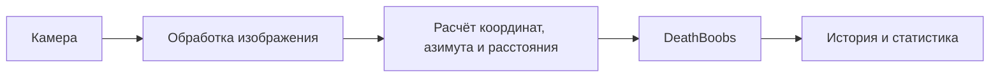
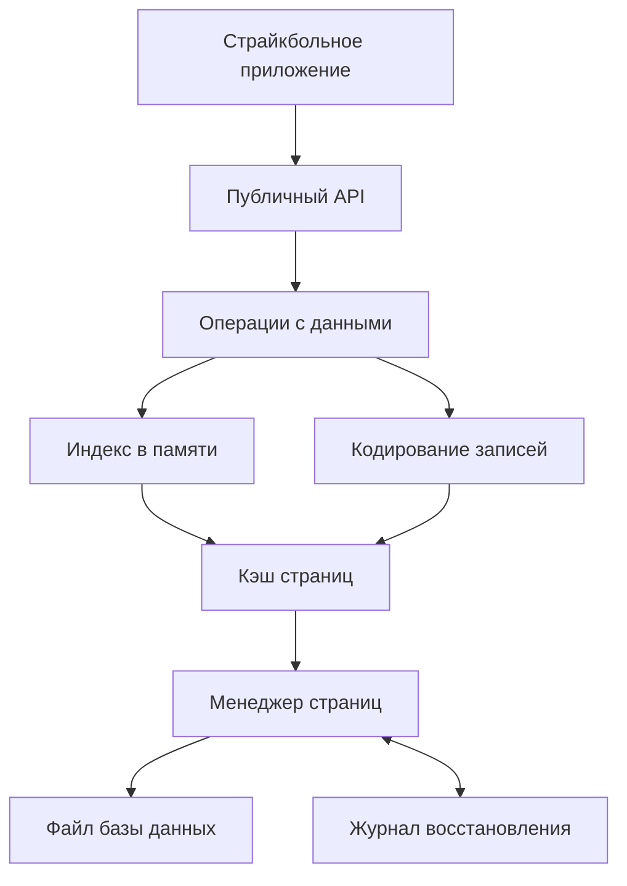

# Архитектура DeathBoobs

Часть 2 реализована: модели и кодек, Database API и RAM-индексы. Этот документ
также описывает планируемые компоненты; настоящие Storage, Transaction, журнал
и кэш страниц пока не реализованы в данном checkout. Действующие контракты
части 2: [records.md](records.md) и [database.md](database.md).

## 1. Назначение

DeathBoobs — локальная встраиваемая база данных для страйкбольного приложения.

Приложение получает изображение с камеры, обнаруживает цель и вычисляет её параметры: координаты, азимут, расстояние и уверенность распознавания. База данных принимает готовый результат обработки и сохраняет его для последующего чтения и анализа.

DeathBoobs создаётся только для этого приложения. Поддержка произвольных пользовательских таблиц, универсального SQL и сторонних приложений не является целью проекта.

## 2. Границы ответственности

DeathBoobs отвечает за:

- хранение игровых сессий;
- хранение обнаружений целей;
- поиск сохранённых записей;
- получение истории обнаружений;
- сохранение целостности данных;
- восстановление после незавершённой записи;
- управление собственным файлом базы данных.

DeathBoobs не отвечает за:

- получение изображения с камеры;
- распознавание человека на изображении;
- вычисление координат, азимута и расстояния;
- управление игровыми правилами;
- передачу данных по сети;
- хранение видеопотока.

Обработка изображения выполняется приложением до обращения к базе данных.



## 3. Основные требования

База данных должна:

- работать локально без отдельного серверного процесса;
- подключаться к приложению как библиотека;
- хранить данные в одном основном файле;
- сохранять данные между запусками приложения;
- поддерживать частую запись обнаружений;
- быстро возвращать обнаружения текущей игровой сессии;
- позволять читать историю в заданном интервале времени;
- не оставлять основной файл в повреждённом состоянии после сбоя;
- иметь предсказуемое потребление памяти.

## 4. Модель данных

На первом этапе база содержит два основных вида записей: игровые сессии и обнаружения целей.

### 4.1. Игровая сессия

Игровая сессия объединяет обнаружения, сделанные в рамках одной игры.

| Поле | Назначение |
| --- | --- |
| `id` | Уникальный идентификатор сессии |
| `started_at` | Время начала игры |
| `finished_at` | Время завершения игры или пустое значение |
| `status` | Текущее состояние сессии |

### 4.2. Обнаружение цели

Запись создаётся после того, как приложение обработало кадр и вычислило параметры цели.

| Поле | Назначение |
| --- | --- |
| `id` | Уникальный идентификатор обнаружения |
| `session_id` | Идентификатор игровой сессии |
| `timestamp` | Время обнаружения |
| `target_id` | Идентификатор цели, если она распознана |
| `x` | Координата цели на восток от начала координат сессии |
| `y` | Координата цели на север от начала координат сессии |
| `azimuth` | Азимут на цель |
| `distance` | Расстояние до цели |
| `confidence` | Уверенность распознавания |
| `frame_reference` | Необязательная ссылка на сохранённый кадр |

Размеры, единицы fixed-point, допустимые диапазоны, признаки наличия и бинарное
представление версии 1 определены в [records.md](records.md) и
`include/deathboobs/records.h`. Их соответствие данным камеры проверяется
адаптером приложения до интеграции.

Изображения не хранятся внутри основного файла базы. Если приложению потребуется сохранить кадр, оно сохраняет его отдельно, а база хранит только ссылку.

## 5. Общая архитектура



Архитектура состоит из следующих компонентов:

1. публичный API;
2. слой операций с данными;
3. кодек записей;
4. индекс в памяти;
5. кэш страниц;
6. менеджер страниц;
7. журнал восстановления;
8. файл базы данных.

## 6. Публичный API

База предоставляет приложению только операции, необходимые его сценариям:

- открыть или создать базу;
- корректно закрыть базу;
- начать игровую сессию;
- завершить игровую сессию;
- сохранить обнаружение;
- получить сессию по идентификатору;
- получить обнаружение по идентификатору;
- получить обнаружения выбранной сессии через callback;
- получить обнаружения за замкнутый интервал времени через callback.

Публичный C11 API объявлен в `include/deathboobs/database.h`, правила владения
и ошибки описаны в [database.md](database.md). Удаление завершённой сессии
относится к будущему расширению и не входит в часть 2.

## 7. Слой операций

Слой операций реализует прикладные действия и скрывает внутреннее устройство файла от приложения. Он:

- проверяет входные значения;
- назначает идентификаторы;
- кодирует записи;
- находит нужные страницы;
- обновляет индексы;
- управляет началом и завершением записи;
- возвращает результат или ошибку.

Отдельный парсер запросов и оптимизатор не требуются. Все поддерживаемые операции заранее определены API.

## 8. Файл и страницы

Данные хранятся в одном основном файле. Файл делится на страницы фиксированного
размера 4096 байт. Неизменённый формат Storage 1.0 описан в
[storage.md](storage.md).

```text
database.db
├── заголовок файла
├── служебные страницы
├── страницы игровых сессий
├── страницы обнаружений
└── страницы записей
```

Заголовок файла Storage 1.0 содержит:

- сигнатуру формата;
- версию формата;
- размер страницы;
- неизменяемые параметры формата;
- CRC-32 и зарезервированные нулевые байты.

Следующие ID записей не хранятся в заголовке Storage. Независимые максимумы ID
сессий и обнаружений восстанавливаются Database при проходе по страницам;
следующий ID вычисляется с проверкой исчерпания диапазона. Количество страниц
Storage вычисляет по размеру файла.

Менеджер страниц отвечает за:

- чтение страницы;
- запись страницы;
- выделение новой страницы;
- повторное использование освобождённых страниц в будущем расширении;
- проверку границ файла;
- передачу изменённых страниц журналу восстановления.

## 9. Кодирование записей

Записи имеют стабильное бинарное представление, которое не зависит от расположения структур языка программирования в памяти.

Кодек отвечает за:

- преобразование записи в последовательность байтов;
- восстановление записи из байтов;
- проверку длины и корректности полей;
- поддержку версии формата записи;
- представление необязательных значений.

Нельзя записывать структуры из памяти напрямую в файл: выравнивание, порядок байтов и размеры типов могут измениться между платформами или версиями компилятора.

## 10. Индекс в памяти

Первая версия не хранит B+ tree или другой постоянный индекс. Записи последовательно добавляются в файл, а при открытии базы выполняется один проход по страницам и строится небольшой индекс в оперативной памяти.

Индекс должен поддерживать следующие пути поиска:

- игровая сессия по `id`;
- обнаружение по `id`;
- обнаружения по `session_id` и `timestamp`.

Append-only размещение сохраняет порядок записи; timestamps могут поступать
не по порядку. Хронологическую историю сессии обеспечивает RAM-индекс
`(session_id, timestamp, detection_id)`. Если объём данных сделает полный
проход при открытии слишком медленным, постоянный индекс будет рассмотрен
отдельной версией формата.

Произвольные пользовательские индексы не поддерживаются.

## 11. Кэш страниц

Кэш уменьшает количество обращений к накопителю. Он хранит ограниченное число недавно использованных страниц в оперативной памяти.

Для каждой страницы кэш хранит:

- номер страницы;
- данные страницы;
- признак изменения;
- признак использования;
- количество активных ссылок.

Для вытеснения страниц достаточно простого алгоритма Clock. Изменённая страница перед вытеснением должна быть безопасно записана на накопитель.

## 12. Атомарность и восстановление

Первая версия использует rollback journal. Перед изменением существующей страницы её исходное содержимое записывается в отдельный файл журнала.

Упрощённый порядок записи:

1. открыть транзакцию записи;
2. сохранить исходные версии изменяемых страниц в журнал;
3. синхронизировать журнал с накопителем;
4. записать изменённые страницы в основной файл;
5. синхронизировать основной файл;
6. отметить транзакцию завершённой;
7. очистить журнал.

Если приложение завершилось до фиксации, при следующем открытии база восстанавливает исходные страницы из журнала.

На первом этапе одновременно допускается только одна операция записи. Сложные уровни изоляции и MVCC не требуются.

## 13. Параллельный доступ

База предназначена для одного приложения и одного процесса. В первой версии поддерживается:

- один открытый экземпляр базы;
- один поток записи в каждый момент времени;
- последовательное выполнение операций изменения;
- чтение через тот же экземпляр базы.

Одновременное открытие файла несколькими процессами не поддерживается. Внутрипроцессная синхронизация будет уточнена после выбора языка и модели выполнения приложения.

## 14. Ошибки

API должен различать как минимум следующие категории ошибок:

- файл не найден;
- неверная сигнатура или версия формата;
- повреждённая страница или запись;
- некорректные входные данные;
- игровая сессия не найдена;
- обнаружение не найдено;
- операция недопустима в текущем состоянии;
- недостаточно места;
- ошибка чтения, записи или синхронизации;
- требуется восстановление из журнала.

Ошибки не должны приводить к аварийному завершению приложения, если состояние файла позволяет безопасно продолжить работу или выполнить восстановление.

## 15. Что не входит в первую версию

В первую версию не входят:

- SQL и другой текстовый язык запросов;
- произвольные таблицы и пользовательские схемы;
- сетевой сервер;
- пользователи, роли и права доступа;
- репликация и синхронизация между устройствами;
- распределённое хранение;
- MVCC;
- параллельное выполнение запросов;
- хранимые процедуры и триггеры;
- полнотекстовый поиск;
- хранение изображений и видео внутри файла базы;
- универсальный оптимизатор запросов.

Эти возможности могут быть рассмотрены только при появлении конкретной потребности приложения.

## 16. Открытые решения

Для текущей версии зафиксированы C11 поверх PUNos (Linux x86_64),
little-endian и fixed-point единицы/точность/диапазоны из
[records.md](records.md). Публичные API и бинарные форматы описаны в
соответствующих заголовках и документах. До интеграции и следующих версий
остаётся уточнить:

- максимальную частоту обнаружений;
- ожидаемый срок и объём хранения истории;
- соответствие локальных координат и пределов данным приложения;
- потребуется ли многопоточное чтение сверх текущего однопоточного контракта;
- потребуется ли автоматическое удаление старых данных;
- потребуется ли шифрование файла базы.

Несовместимые изменения уже сохранённых записей требуют новой версии формата
и согласованной миграции; они не меняют молча формат Storage 1.0.
