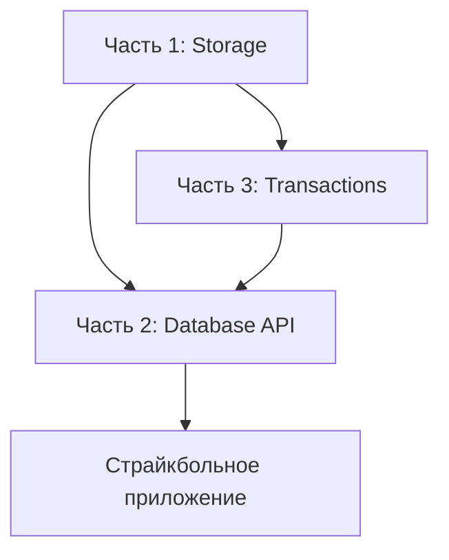

# Распределение работы

## 1. Общая цель

Первая версия DeathBoobs — специализированная embedded-база для страйкбольного приложения. Она хранит игровые сессии и обнаружения целей в локальном файле PUNos.

Реализация выполняется на C11. В качестве системных зависимостей используются `libcore`, `libfile`, `libmem` и `libstr` из PUNos.

## 2. Общие решения

До начала реализации зафиксированы следующие решения:

| Решение | Значение |
| --- | --- |
| Модель | Встраиваемая специализированная база |
| Язык | C11 |
| Размер страницы | 4096 байт |
| Порядок байтов | Little-endian |
| Размещение записей | Append-only |
| Постоянный индекс | Не входит в первую версию |
| Индекс первой версии | Строится в памяти при открытии |
| Конкурентная запись | Один писатель |
| Восстановление | Rollback journal |
| Изображения | Отдельные файлы; база хранит ссылку |
| Дробные значения | Fixed-point целые числа |

## 3. Часть 1 — файловое хранилище

Ответственный реализует:

- заголовок файла;
- формат страниц;
- открытие и создание файла базы;
- проверку сигнатуры и версии;
- чтение страницы;
- перезапись существующей страницы;
- добавление страницы в конец файла;
- контрольные суммы;
- принудительную запись через `file_flush()`;
- проверки размера и структуры файла;
- модульные тесты хранилища.

Публичная граница части — `include/deathboobs/storage.h`.

Часть 1 не интерпретирует игровые сессии и обнаружения, не ведёт журнал транзакций и не строит прикладные индексы.

## 4. Часть 2 — модель данных и Database API

Ответственный реализует:

- структуры игровой сессии и обнаружения;
- кодирование и декодирование записей;
- начало и завершение сессии;
- сохранение обнаружения;
- чтение записи по идентификатору;
- чтение истории сессии через callback;
- выборку по интервалу времени;
- индекс в оперативной памяти;
- восстановление индекса при открытии.

Часть 2 использует только публичные API Storage и Transaction. Прямые вызовы `libfile` запрещены.

## 5. Часть 3 — транзакции и интеграция

Ответственный реализует:

- rollback journal;
- фиксацию и откат записи;
- восстановление после незавершённой операции;
- защиту от повторного открытия файла на запись;
- fault-injection тесты;
- сборку с PUNos;
- интеграционные тесты полного сценария игры;
- адаптер для страйкбольного приложения.

Часть 3 использует публичный API Storage и не обращается к внутренним структурам его реализации.

## 6. Зависимости

Чтобы работа могла идти параллельно, части 2 и 3 используют fake-реализации ещё не готовых зависимостей.

## 7. Владение кодом

| Часть | Основные каталоги |
| --- | --- |
| Storage | `src/storage/`, `tests/unit/storage/`, `include/deathboobs/storage.h` |
| Database API | `src/database/`, `src/codec/`, `tests/unit/database/` |
| Transactions | `src/transaction/`, `tests/recovery/`, `tests/integration/` |

Общие заголовки формата и ошибок меняются только после согласования всех трёх частей.

## 8. Порядок интеграции

1. Зафиксировать заголовки и бинарный формат Storage.
2. Реализовать и протестировать Storage.
3. Подключить Transaction к реальному Storage.
4. Подключить Database API к Storage и Transaction.
5. Провести тесты восстановления.
6. Провести сквозной тест игровой сессии.

Текущий активный этап — часть 1.
